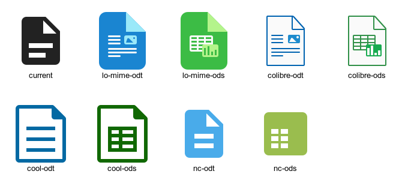

# 新增文件的 ODT／ODS 圖示候選（2026-11-03）

擁有者：「新增文字文件」的圖示不像 LibreOffice 風格，找找看有沒有可以用的 odt 跟 ods 圖示。

**結論：LibreOffice 原始碼裡就有兩組可用的，授權都相容 AGPL 的宿主 app。** 現在用的是單色字形（`RegisterTemplateCreatorListener::ICON`，Files 動作也是同一個），所以看起來不像。

| 標籤 | 來源 | 樣子 | 授權 | 用得了嗎 |
|---|---|---|---|---|
| `current` | 宿主現在的字形 | 單色頁面加兩條線 | 我們的 | 這就是要換掉的 |
| `lo-mime-odt`／`-ods` | `libreoffice-26-8/sysui/desktop/icons/hicolor/scalable/mimetypes/oasis-text.svg`、`oasis-spreadsheet.svg` | 藍色、綠色實心頁面，作業系統裡 .odt／.ods 檔案的圖示 | MPL-2.0（LibreOffice 原始碼，`COPYING.MPL`；2022 年 tdf#132398 重做） | 可以，要保留 MPL 聲明 |
| `colibre-odt`／`-ods` | `libreoffice-26-8/icon-themes/colibre_svg/res/odt_48_8.svg`、`ods_48_8.svg` | 白底線框，LibreOffice 程式裡的文件圖示 | CC0（`icon-themes/colibre/COPYING-ICONS`） | 可以，沒有義務 |
| `cool-odt`／`-ods` | `cool-26-04/browser/images/x-office-*.svg` | Collabora 的粗框 | 參考 | 不建議：這是 Collabora 的樣子，不是 LibreOffice |
| `nc-odt`／`-ods` | Nextcloud `core/img/filetypes/x-office-*.svg` | Nextcloud 內建 | 參考 | 那是 Nextcloud 的，不是 LibreOffice |

〔已讀授權檔、已實際轉圖比對〕

## 建議

`lo-mime`：使用者在自己電腦上看到的 .odt／.ods 就是這兩個，最能一眼認出「這是 LibreOffice 的文件」。MPL-2.0 是檔案層級的 copyleft，放進 AGPL 的 app 沒有衝突，只要保留授權聲明、標明出處（在 app 加一份 `img/README` 或 NOTICE）。

想要完全沒有義務、而且和 LibreOffice 程式內風格一致，就選 `colibre`。

兩組都有藍、綠兩色，ODT 和 ODS 一眼就分得出來。同一組也可以順便換掉 Files 裡「Open in LiteCore」動作的圖示。
